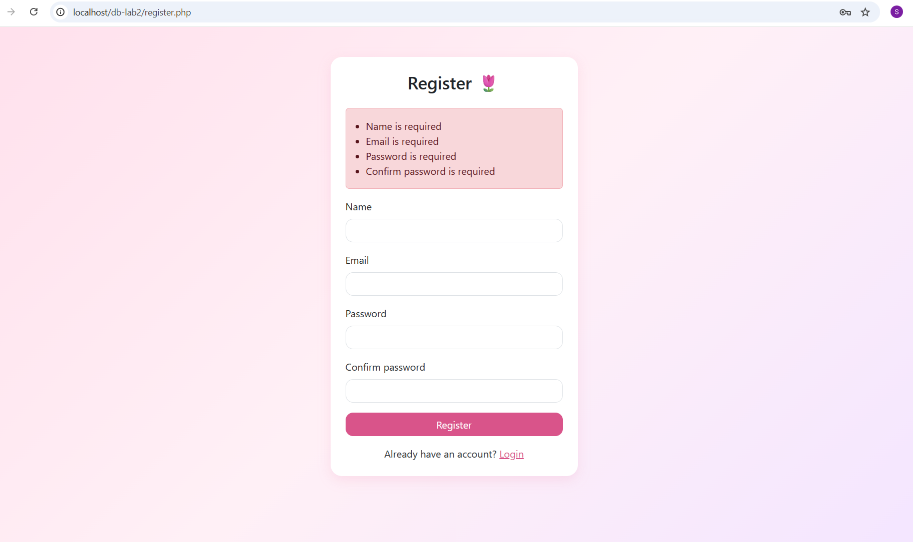
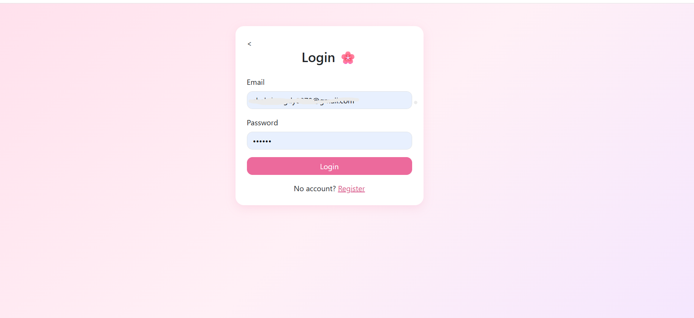
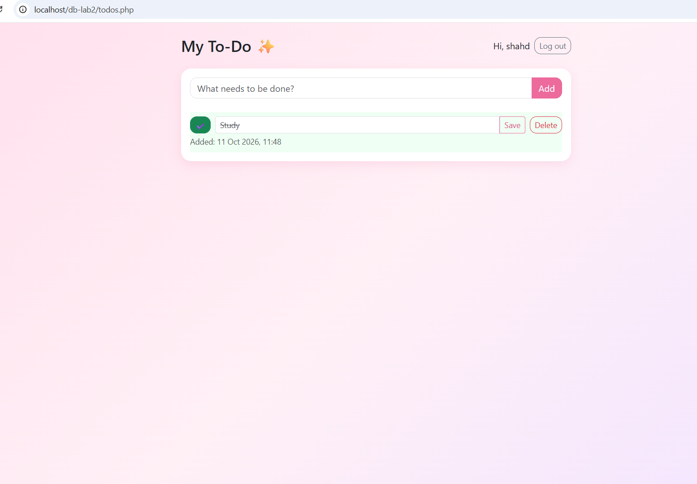
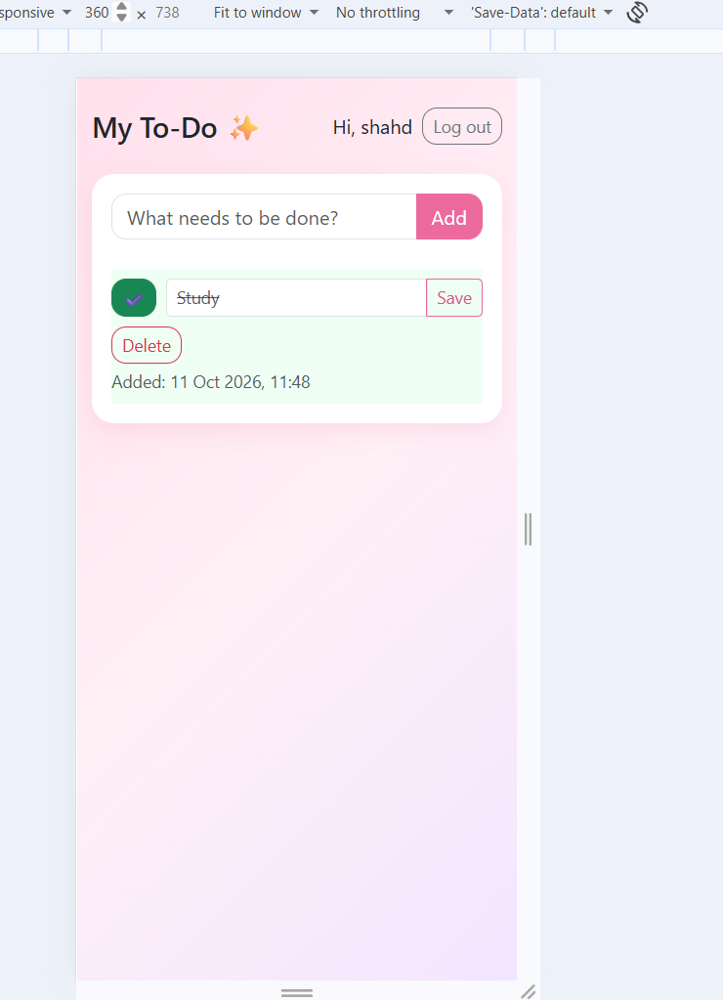

# Lab 2: Login & To-Do Application

Introduction to Database Systems, Fall 2026
Alexandria National University, Faculty of Engineering

## 1. Team

| Shahd Magdy Abdelghany | 2304047 | Everything: database design, back end, front end, validation, styling, Git/GitHub, README |
Worked alone.

## 2. Technology

| Back end | PHP 8.2 (plain PHP, no framework) with PDO |
| Front end | HTML, CSS, JavaScript, Bootstrap 5 |
| Database | MySQL (via XAMPP), database name `registration` |
| Tools | XAMPP, VS Code, DBeaver, Git, GitHub |

No ORM is used. All SQL is written by hand, with prepared statements.

## 3. How to run it

1. Install **XAMPP** (with PHP 8.x, Apache and MySQL).
2. Copy this project folder to `C:\xampp\htdocs\db-lab2`.
3. Open the XAMPP Control Panel and **Start** Apache and MySQL.
4. Build the database: open `database/schema.sql` in DBeaver (or phpMyAdmin) and run the whole script (in DBeaver: `Alt + X`).
5. Copy `.env.example` to `.env` and set the values:
```
   DB_HOST=localhost
   DB_NAME=registration
   DB_USER=root
   DB_PASS=
```
   (XAMPP's default `root` user has an empty password.)
6. Open the address: `http://localhost/db-lab2/register.php`
7. Register a new user. You are logged in and taken to the to-do list.

## 4. Features

| # | Feature | Status |
|---|---|---|
| R1 | Register (name, email, password, confirm password), `Email Already Exists` for duplicates, automatic login afterwards | Done |
| R2 | Login with the same `Invalid email or password` message for wrong email or wrong password; Logout destroys the session | Done |
| R3 | Private list: visitors are redirected to the login page; each user sees only their own to-dos, newest first | Done |
| R4 | Add a to-do | Done |
| R5 | Edit the title | Done |
| R6 | Mark done / not done | Done |
| R7 | Delete, with an "Are you sure?" confirmation | Done |
| R8 | Validation in the browser (JavaScript) and on the server, with the exact messages | Done |
| R9 | Passwords stored as bcrypt hashes; only the given queries, always with parameters; `user_id` always comes from the session | Done |
| R10 | Consistent, responsive UI (works at 360 px), error messages, visible state for done to-dos, empty-list message, name and logout button | Done |
| Bonus | Creation date shown under each to-do | Done |

## 5. Screenshots

**Register page with error messages**



**Login page**



**To-do list (one to-do done)**



**Phone-sized window (360 px)**



## 6. Answers

**(a) Why do UPDATE and DELETE contain `AND user_id = ?`, and what changes if you remove it?**

The id of a to-do comes from the browser, so anybody can send somebody else's to-do number. Adding `AND user_id = ?` (the id of the logged-in user, taken from the session) makes the statement change zero rows when the to-do is not yours. If it is removed, any logged-in user could edit or delete the to-dos of other users just by sending their `todo_id`.

**(b) What happens if you insert a to-do for a `user_id` that does not exist, and which constraint is that?**

MySQL rejects the insert with an error (`Cannot add or update a child row: a foreign key constraint fails`). This is the **foreign key constraint** (referential integrity): every value of `todos.user_id` must exist in `users.user_id`, so no to-do can exist without an owner.

**(c) Why do you store a hash and not the password?**

If the database is leaked, a stored password would be exposed directly, and many people reuse passwords on other sites. A bcrypt hash cannot be reversed, it is salted (equal passwords give different hashes) and it is slow on purpose, which makes guessing attacks very expensive. To log in, the app compares the typed password with the hash using `password_verify()`.

**(d) The `name` column is NOT NULL: why did you still need your own check for an empty name?**

An empty text `''` is a value, so `NOT NULL` accepts it. `NOT NULL` only forbids a missing (NULL) value. Only our own checks (in JavaScript and on the server, with `trim()` so that spaces-only names are also refused) can reject an empty name.